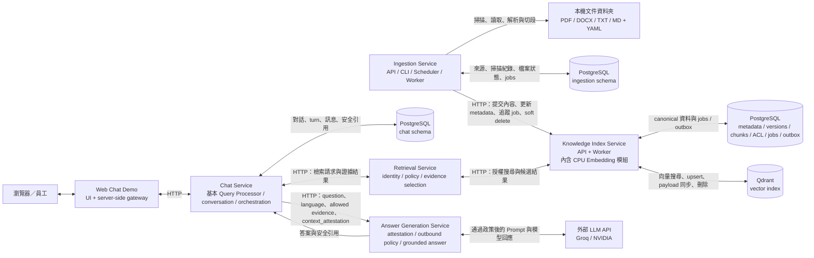
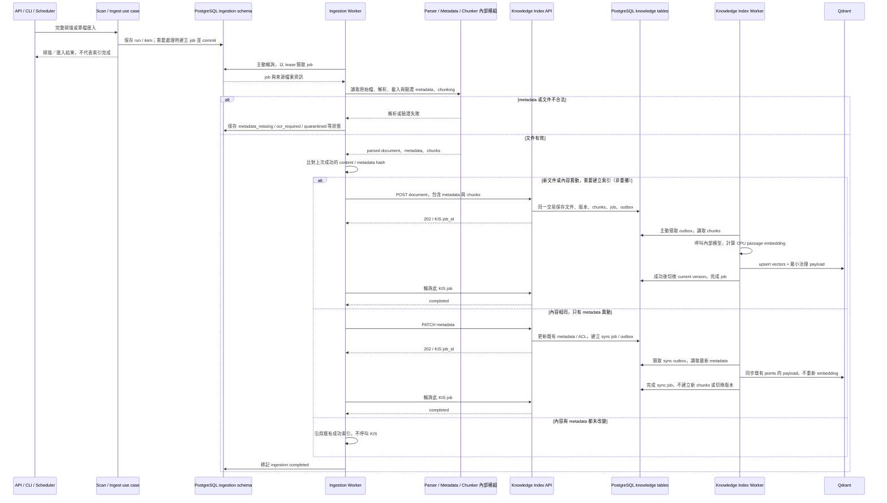
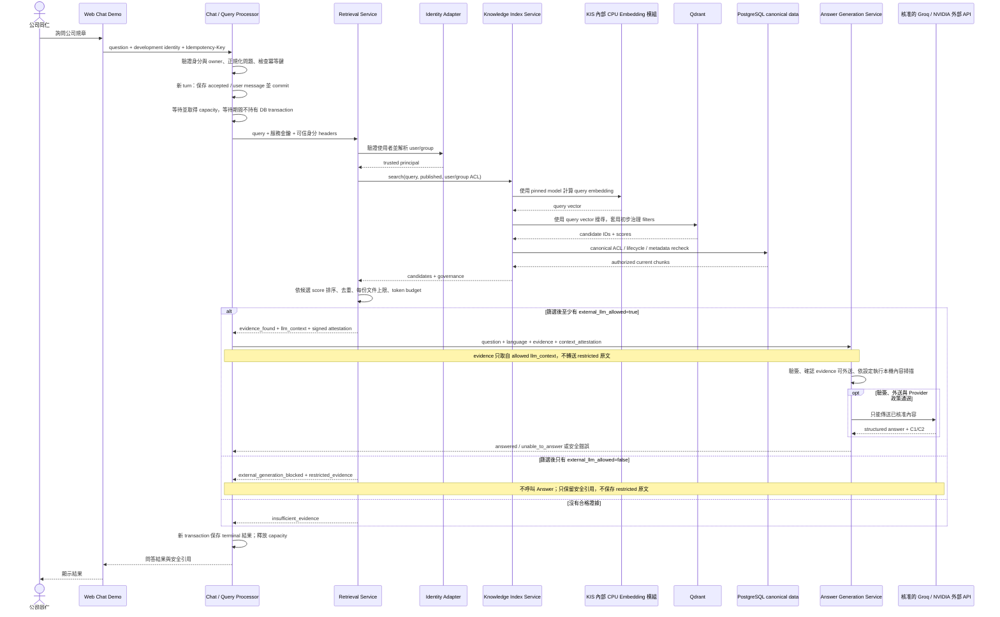

# Help Desk RAG

> 如果你正在用這些專案學 Python，請先看
> [`Python 與 Clean Architecture 學習指南`](./docs/python-clean-architecture-learning-guide.md)。
> 各後端服務的 production modules 也有繁體中文架構、語法與流程註解。

後續改善多元問答的優先順序、施工項目與驗收標準，請看
[`升級計劃 v1`](./升級計劃v1.md)。目前已進入 U1 契約／安全設計（僅文件），
草案見 [`U1 跨服務契約`](./docs/rag-upgrade-v1-contracts.md)；尚未升級 production 功能。
U0 現況盤點完成，但回答品質尚未量測；未完成的補證與限制保留於
[`U0 基線報告`](./docs/rag-upgrade-v1-baseline.md)，不將設計進度當成品質 PASS。

本專案以單一 Git repository（建議名稱 `helpdesk-rag`）管理整套系統。Repository 根目錄
是這份 README 所在的共同上層；各服務保留自己的依賴鎖定檔、Dockerfile、Compose 與測試，
可獨立建置與部署。只在共同上層初始化 Git，不在各服務內建立巢狀 repository。
本機資料夾可以保留目前名稱，無須為了 GitHub 改動既有路徑。

本目錄目前包含六個獨立專案：五個後端服務與一個無登入 Web Chat Demo。
它們透過 HTTP 與共用 Docker network 串接；不是六個各自完整的 RAG 系統。

| 專案 | 主要責任 | 對外埠 | 是否保存狀態 |
|---|---|---:|---|
| [`ingestion-service`](./ingestion-service/README.md) | 掃描來源、驗證 metadata、解析文件、chunking、追蹤匯入工作 | `8090` | 是，使用 PostgreSQL `ingestion` schema |
| [`knowledge-index-service`](./knowledge-index-service/README.md) | 保存文件、版本、chunk、ACL，產生 embedding，維護 Qdrant index，提供向量搜尋 | `8080` | 是，使用 PostgreSQL 與 Qdrant |
| [`retrieval-service`](./retrieval-service/README.md) | 接收同仁問題與可信身分，套用 published／ACL／外送政策，回傳安全證據與引用 | `8100` | 否，為 stateless service |
| [`answer-generation-service`](./answer-generation-service/README.md) | 驗證簽章與外送政策，組 Prompt、呼叫 LLM，驗證答案格式與 citation 對應 | `8110` | 否，為 stateless service |
| [`chat-service`](./chat-service/README.md) | 保存對話、基本 Query Processor、協調一次問答、冪等與併發控制 | `8120` | 是，使用 PostgreSQL `chat` schema |
| [`web-chat`](./web-chat/README.md) | 員工提問 Demo 畫面與 server-side gateway，只呼叫 Chat API | `8130` | 無自己的 DB；對話由 Chat 保存 |

兩條主流程可以先記成：

- 文件匯入：Ingestion 讀取資料夾、解析／切段 → Knowledge Index 先保存 PostgreSQL 資料與工作 → KIS Worker 向量化並寫入 Qdrant。
- 員工問答：Web Chat → Chat → Retrieval → Knowledge Index 搜尋；Chat 再將允許的證據交給 Answer → LLM，保存結果後回到畫面。

五個後端服務採用 Clean Architecture：

```text
presentation (FastAPI / CLI) -> application use cases -> domain
                                      ^
                                      |
                          infrastructure adapters
```

Domain 與 Application 不直接依賴 FastAPI、SQLAlchemy、Qdrant 或檔案解析套件。
Web Chat 採用輕量的 Presentation／Application／Infrastructure 分層，前端是
HTML、CSS、原生 JavaScript，不是 React，也沒有另外建立業務 Domain 或資料庫。

## 完整架構



這是服務與資料所有權的概覽，不是每個節點各部署一個 container 的部署圖。
單向箭頭表示標註的呼叫或讀取方向；HTTP 雙向箭頭表示請求／回應，DB 雙向箭頭表示
服務主動讀寫，不代表資料庫主動推送工作。圖中 LLM 路徑只呈現外部 API 模式，測試替身不列入。

圖中的三個 PostgreSQL 節點表示不同的邏輯資料所有權；本機預設共用 KIS Compose 提供的
同一個 PostgreSQL instance／`knowledge` database。Ingestion 與 Chat 分別使用獨立的
`ingestion`、`chat` schema，不直接讀寫彼此的業務資料表。

重要邊界：

- Ingestion Service 不產生 embedding，也不直接操作 Qdrant。
- Retrieval Service 不直接操作 PostgreSQL 或 Qdrant，而是透過 Knowledge Index Service
  取得已套用 ACL 的候選資料。
- Knowledge Index Service 是文件 metadata、版本、完整 chunk 與 ACL 的唯一真實來源。
- CPU embedding 是 KIS 內部的模型元件，不是獨立 HTTP service；KIS Worker 計算文件向量，
  KIS 搜尋流程計算問題向量，目前使用 `multilingual-e5-small`。模型只回傳向量，由 KIS 的
  use case 與 Qdrant adapter 負責索引讀寫；Qdrant 不負責執行這個 embedding 模型。
- Qdrant 是可重建的向量索引，不是公司文件的唯一資料庫。
- Answer Generation 是唯一能呼叫外部 LLM 的服務；它只接受簽章的 allowed context。
- Chat 負責協調 Retrieval 與 Answer；Retrieval 不會自行呼叫 Answer。
- Web Chat 只呼叫 Chat；它不直接查資料庫、執行 embedding 或呼叫外部 LLM。

### 與最初架構圖的對應

| 最初規劃的元件 | 目前實作位置 |
|---|---|
| Client | `web-chat` 無登入 Demo |
| Chat Service | `chat-service` 的 API 與問答協調流程 |
| Query Processor | Chat 的 `application/query_processor.py`，不是獨立服務 |
| Conversation Store | PostgreSQL `chat` schema |
| Retrieval Service | `retrieval-service`，透過 KIS 搜尋 |
| LLM Service | `answer-generation-service` 與 Provider adapters |
| Company Document DB | KIS 管理的 PostgreSQL 文件 metadata、版本、chunk、ACL；不是另一個空白 DB |
| Vector Store | 自建 Qdrant，由 KIS 管理 |
| 文件匯入流程 | 額外拆成 `ingestion-service`，負責來源掃描與解析 |

目前 Company Document DB 保存的是文件及檢索所需資料；尚未建立可直接 SQL 統計的
「招生系所名單／名額」等專用結構化業務表。服務之間主要使用 HTTP，匯入背景工作使用
PostgreSQL jobs／outbox，沒有另外部署通用 Message Bus。

## Intel 開發與 ARM64 部署

各專案各自的原始碼、`uv.lock` 與 Dockerfile 支援兩個目標，不需要維護兩套平台分支：

- 你的 Intel x86 Mac 以 Docker 原生建置時是 `linux/amd64`。
- Oracle Cloud ARM server 原生建置時是 `linux/arm64`。
- Compose 沒有寫死 `platform`，所以 `docker compose build` 會自動選擇目前主機架構。
- 若要在 Intel Mac 預先檢查 ARM image，可在任一服務執行 `make build-arm64`；這會透過
  Docker Buildx／模擬器建置，速度會比原生 ARM 慢。
- Answer Generation 呼叫 Groq 或 NVIDIA 的遠端 API，不代表本機或 Oracle 主機需要 GPU。

六個專案都提交各自的 `uv.lock`，Docker build 使用 `uv sync --frozen`。因此每次 build 不會重新
解析最新版套件；`pyproject.toml` 與 lock 不一致時會直接失敗，提醒開發者明確執行
`make lock` 並審查變更。`uv` 與 Python base image 也固定版本和 multi-architecture manifest
digest，避免相同程式在不同日期偷偷換掉 build 基底。

Knowledge Index Service 另外將 Linux 的 PyTorch 明確鎖定到官方 CPU wheel index；lock 同時
含有 `linux/amd64` 與 `linux/arm64` 的 CPU wheels，不會下載 CUDA、cuDNN 或其他 NVIDIA
runtime。可在 Intel Mac 執行：

```bash
cd knowledge-index-service
make lock-check
make verify-cpu-amd64
```

正式 ARM 主機部署後可執行 `make verify-cpu-arm64`。輸出中的 `CUDA= None` 才是預期結果。
這些建置與重建指令不會刪除既有 PostgreSQL、Qdrant 或 model-cache Docker volumes。
KIS 與 Ingestion 的 Compose 也只由 `migrate` service 建置一次 image，其餘角色直接重用，
避免多個 service 同時 export 到同一 tag 的 `image already exists` 競態。

## 專案一：Ingestion Service

### 它負責什麼

Ingestion Service 是「文件進入知識庫」的入口。第一版讀取本機資料夾，未來可在不改變
Application Core 的情況下加入 SharePoint connector。

主要功能：

- 支援 `.pdf`、`.docx`、`.txt`、`.md`。
- 解析文字型 PDF 並保留頁碼；掃描型 PDF 標記為 `ocr_required`，第一版不做 OCR。
- 合併資料夾預設 metadata 與單檔 YAML sidecar。
- 必要 metadata 缺漏時停止該文件，不從檔名或內文猜測。
- 依 tokenizer 限制切段；parser 有章節資訊時保留章節。PDF 目前以頁面文字擷取為主，
  不保證能還原表格欄列或推導每頁所屬章節。
- 偵測新增、內容修改、metadata-only 修改、消失與重新出現。
- 每日 `02:00 Asia/Taipei` 自動執行完整掃描。
- 文件連續兩次完整掃描消失才要求 KIS soft delete。
- 保存來源、scan run、source item、ingestion job 與錯誤狀態。

Metadata 範例（`title`、`document_type`、`owner_department`、`document_owner` 為必要欄位；
其餘欄位也會驗證，但可依預設與 sidecar 合併規則提供）：

```yaml
title: 遠端工作管理辦法
document_type: policy
owner_department: HR
document_owner: hr@example.com
confidentiality: internal
status: published
language: zh-TW
external_llm_allowed: false
acl:
  - principal_type: group
    principal_id: all-employees
    effect: allow
```

完整 metadata 規則與 sidecar 命名方式請看
[`ingestion-service/README.md`](./ingestion-service/README.md#metadata)。
本機預設將檔案放在 `ingestion-service/documents/`，容器唯讀掛載至 `/data/documents`。
原始 PDF／DOCX 仍由來源資料夾保管；資料庫內的 chunks 不是原始檔備份。

### 匯入事務流程

API、CLI 與 Scheduler 都是共用 Application use case 的入口；Scheduler 直接呼叫掃描
use case，不會透過 HTTP 呼叫 Ingestion API。以下呈現文件處理的主要成功路徑與驗證失敗
分支；Worker 會獨立輪詢資料庫，不是由 API 或 PostgreSQL 主動推送工作。



事務一致性重點：

- KIS 回傳 `202` 代表接受請求，不保證本次新建了索引工作或 embedding 已完成。
  POST 冪等重播可回傳既有結果；若已索引完成且沒有待處理工作，`job_id` 可為 `null`，
  Ingestion 不會因此重新 embedding 或輪詢不存在的 job。上圖的新內容分支呈現非重播情況。
- 掃描結果 `completed` 只代表掃描完成；`queued_count` 表示待處理文件，仍須追蹤 ingestion job 與 KIS indexing job。
- Ingestion 先在自己的 PostgreSQL schema 保存 run/item/job，Worker 才進行耗時解析。
- KIS 在同一資料庫交易中寫入文件資料與 durable outbox，避免「DB 已寫入但索引工作遺失」。
- Worker 使用 lease、冪等鍵與重試；程序中斷後工作可以重新被領取。
- 只有新版本完整索引成功後，KIS 才切換目前版本，查詢不會看到半套資料。
- Metadata-only 修改走 PATCH，只更新 PostgreSQL 與 Qdrant payload，不重做 embedding。
- 原始檔由 Worker 處理時讀取，不是從 `ingestion` schema 取出整份檔案；Parser／Metadata
  Loader／Chunker 是內部模組，不自行呼叫 KIS。遠端 HTTP 由 Worker 的應用流程協調。
- 上圖省略 lease 續租、重試與 soft-delete 分支：文件連續兩次完整掃描消失且通過刪除保護後，
  Ingestion 排入 delete job，由 Worker 呼叫 KIS soft delete；KIS 再透過 outbox 清除向量索引。

## 專案二：Knowledge Index Service

### 它負責什麼

Knowledge Index Service 是知識資料的核心寫入與搜尋服務，也是 PostgreSQL 和 Qdrant 之間的
一致性邊界。

PostgreSQL 保存：

- 文件來源、擁有者、部門與自訂 metadata。
- 文件版本、生命週期日期、parser／embedding model revision。
- 完整 chunk 內容、section、頁碼、token count。
- user/group allow/deny ACL、機密等級、`external_llm_allowed`。
- indexing jobs、outbox、lease、重試與 soft-delete 狀態。

Qdrant 只保存：

- chunk/document/version ID。
- embedding vector。
- current-version、status、language、confidentiality 與 ACL 搜尋所需的最小 payload。

### 寫入與索引流程

1. Ingestion 將已解析、已 chunk 的文件送到 `POST /api/v1/documents`。
2. KIS 在 PostgreSQL 建立或恢復文件、版本、chunks、indexing job 與 outbox。
3. KIS Worker 從 outbox 領取工作，在本機 CPU 產生 passage embedding。
4. Worker 將 vectors 寫入 Qdrant。
5. Qdrant 成功後更新 PostgreSQL indexing status 並切換 `current_version_id`。
6. 相同來源與相同 index-payload fingerprint 重送時不建立重複版本。

### 搜尋流程

1. 接收 query、limit、user ID、group IDs、status、language 等 filters。
2. 使用同一個 pinned model 產生 query embedding。
3. 在 Qdrant 進行 current-version、status、language 與 ACL 的第一層篩選。
4. 從 PostgreSQL 批次取得完整 chunks、文件、版本與 ACL。
5. 使用 PostgreSQL canonical 狀態重新檢查 soft delete、目前版本、ACL、生效日、失效日與
   published status。
6. 回傳內容、score、citation fields 與最新 governance metadata。

Qdrant payload 即使因同步延遲仍是舊資料，PostgreSQL 最終檢查仍會阻止已撤銷權限的文件
被回傳。Deny ACL 優先於 allow ACL。

## 專案三：Retrieval Service

### 它負責什麼

Retrieval Service 是「同仁問題」與「Knowledge Index 搜尋 API」之間的政策層。它本身沒有
資料庫、不產生 embedding，也不呼叫 LLM。

主要功能：

- 從可信 identity adapter 取得 `user_id` 與 `group_ids`，不接受 request body 偽造身分。
- 員工查詢永遠只要求 `published` 文件。
- 呼叫 KIS `/api/v1/search`，不直接接觸 PostgreSQL 或 Qdrant。
- 依 score 穩定排序、去重、限制每份文件 chunk 數與外部 LLM context token budget。
- 將結果分成 `llm_context` 與 `restricted_evidence`。
- Citation 只回傳文件名稱、章節與頁碼，不回傳實體路徑或未驗證 URL。
- Dependency timeout、錯誤契約與真正的「沒有證據」使用不同狀態，避免把服務故障誤認為
  公司沒有規章。

### 同仁查詢流程

以下呈現新 turn 成功取得 capacity 後的檢索分支，並以啟用 Groq／NVIDIA 外部 API 的模式
說明生成路徑。冪等重播、capacity 拒絕、依賴故障與重試未全部展開；它們不是「沒有證據」。



回傳狀態：

| 狀態 | 意義 | 上層應如何處理 |
|---|---|---|
| `evidence_found` | 至少有一段證據允許外部 LLM 處理 | 只把 `llm_context` 作為 evidence 傳給 Answer，仍須通過 Answer 的驗證 |
| `external_generation_blocked` | 有證據，但全部禁止外送 | 不呼叫 Answer；目前 Chat／Web Chat 只顯示安全引用，不顯示 restricted 原文 |
| `insufficient_evidence` | 沒有候選通過檢索政策 | 回覆找不到足夠依據，不可要求 LLM 自行猜測 |

無論任何狀態，上層都不可把整份 Retrieval response 序列化後送給外部 LLM；能作為生成
證據的只有 `llm_context`，由 Chat 明確投影後交給 Answer，而不是直接交給 Provider。

Retrieval 會用短效 Ed25519 attestation 封住原始問題與 `llm_context`。Answer Service 必須
重新計算雜湊並驗簽；任何增刪、修改、重新排序或過期，都會在外部 Provider 呼叫前被拒絕。

### 目前檢索能力與限制

目前是向量候選搜尋加確定性排序／篩選，不是 Agentic RAG，沒有關鍵字混合搜尋、
語意 reranker、問題拆解、搜尋迴圈或整份文件統計。

預設 `limit=8`、`CANDIDATE_MULTIPLIER=3`、`MAX_CHUNKS_PER_DOCUMENT=3`、
`MAX_CONTEXT_TOKENS=3000`（實際值依 request 與部署設定）。提高每份文件的 chunk 上限
不會一起提高 `limit`、候選數或 token budget，也不會自動改寫查詢。

所以「這次有幾個系所開放報名」即使找到相關招生段落，也不保證找到完整系所清單。
`evidence_found` 只代表找到允許使用的證據，不代表證據足以回答；相似度分數也不是答案信心值。

## 專案四：Answer Generation Service

Answer Generation Service 是受限的 grounded-answer 元件，不是任意 Prompt Proxy。它會：

- 驗證 Retrieval 的短效 Ed25519 context attestation。
- 再次確認所有 evidence 明確允許外送。
- 依 `policy.yaml` 的啟用狀態，在本機掃描問題與 evidence 的憑證、個資、金融、HR、系統安全規則。
- 使用固定、版本化 Prompt，把 evidence 當成不可信資料而非指令。
- 透過 `LLMProviderPort` 呼叫已實作的 Fake、Groq hosted、NVIDIA hosted Adapter。
- 嚴格驗證 Provider JSON 與 `C1/C2`，再由 signed evidence 重建文件名稱、章節、頁碼。

第一版不做 Streaming、跨公司自動 fallback 或自動遮罩。Fake Provider 供本機／CI；NVIDIA
Trial 只允許 synthetic/public/non-confidential 測試資料，不能作正式員工 Help Desk 後端。

模型收到的是固定 system prompt，加上本次問題、語言與選中的 allowed evidence
（段落文字、文件類型、`C1/C2`、名稱／章節／頁碼），不是整份 PDF，也沒有歷史對話。
`source_path`、`source_url`、API key、attestation 不會作為 Prompt 欄位加入；但原始段落
內文仍可能包含 URL 或敏感字串，欄位投影不等於內容自動去識別。

`answered` 表示答案結構與引用 ID 通過驗證，不是程式已證明每個敘述正確。
證據不足時模型可回 `unable_to_answer`；只有改成真正 Provider 才會生成實際回答，Fake 的
固定答案只用來驗證串接。`/health/ready` 也不會消耗外部額度測試金鑰、模型或 quota 是否可用。

## 專案五：Chat Service

Chat 是「一次問答怎麼完成」的協調者，不負責自己搜尋向量或產生答案。

主要功能：

- 建立、列出、讀取、封存自己的 conversation，依 owner 身分隔離資料。
- 保存 turn、user／assistant message、安全 citation 與可重播的失敗結果。
- 用 `Idempotency-Key` 防止同一問題重送時重複呼叫下游；相同 key、不同內容則拒絕。
- 控制同時處理數、等候逾時與 stale turn recovery。
- 對話永久保存；提供管理員 preview-first、精確選取的清檔 API 與不含內容的稽核紀錄。

一次 turn 的事務流程：

1. 驗證身分、conversation ownership，執行 Query Processor，檢查冪等鍵。
2. 在短交易中保存 accepted turn 與 user message，先 commit。
3. 等待 capacity，再呼叫 Retrieval；等待與 HTTP 不持有資料庫交易。
4. 沒證據或全部 restricted 時直接產生對應結果；有 allowed evidence 才呼叫 Answer。
5. 在新交易中保存成功／失敗終態，釋放 capacity，再回傳結果。Answer POST 不自動 retry。

### Query Processor 已實作，但只是基本版

位置：[`chat-service/src/chat_service/application/query_processor.py`](./chat-service/src/chat_service/application/query_processor.py)。
它檢查問題型別、長度、空白內容，統一 CRLF／LF、Unicode NFC、去除頭尾空白；語言只 trim，
不猜測。處理後的相同問題會送進 Retrieval 與 Answer，避免破壞簽章契約。

它**沒有**意圖分類、LLM rewrite、同義詞擴展、子問題拆解或歷史指代補全。
「保存歷史對話」不等於「模型有多輪記憶」：目前每次問題仍獨立檢索與回答。

## 專案六：Web Chat Demo

Web Chat 是目前已能讓使用者提問的畫面，不是另一個 RAG engine：

- FastAPI 提供靜態 HTML／CSS／原生 JavaScript，server-side HTTP gateway 只串 Chat。
- 建立 conversation、送出問題與冪等鍵，遇到 `202 processing` 時輪詢結果。
- 顯示回答、無法回答／政策阻擋提示與文件名稱、章節、頁碼；動態文字使用 `textContent`。
- 無登入，server-side 使用共用的 Demo identity；不是每位員工各自的正式身分。
- 重新整理只清掉當前畫面，不刪除 Chat DB。沒有歷史側欄、文件上傳、管理後台或 streaming。

啟用哪一家 LLM 是 **Answer Generation** 的設定，不是 Web Chat 或 Chat 的設定。
這個無登入版本只供 localhost 展示，不能直接公開作為全公司正式入口。

## Metadata、ACL 與外部 LLM 政策

### Metadata 如何流動

```text
資料夾預設 / YAML sidecar
  -> Ingestion validation
  -> Knowledge Index PostgreSQL canonical metadata
  -> Qdrant 最小 filter payload
  -> Retrieval policy response
```

### ACL 規則

- ACL 支援 `user`／`group` 與 `allow`／`deny`。
- Deny 優先於 allow。
- 沒有 allow ACL 的一般文件代表公司內部呼叫者皆可查詢。
- `confidential` 與 `restricted` 文件強制至少一筆 allow ACL，避免意外全公司公開。
- Qdrant 先做 ACL candidate filter，PostgreSQL 在回傳前再次以最新 ACL 驗證。

### `external_llm_allowed`

- `true`：有權限的 chunk 可以進入 Retrieval 的 `llm_context`。
- `false`：chunk 只能進入 `restricted_evidence`，絕不可傳送 NVIDIA 或其他外部 LLM API。
- 此欄位來自 PostgreSQL canonical metadata，不信任可能尚未同步完成的 Qdrant payload。

這是第一層文件外送許可，不是外送的全部條件。Answer 還要驗證 attestation、Provider 核准，
以及第二層實際內容掃描。第二層的所有規則與總開關位於
[`policy.yaml`](./answer-generation-service/src/answer_generation_service/infrastructure/outbound_policy/policy.yaml)。
`enabled: false` 只關閉內容掃描，不會跳過 ACL、`external_llm_allowed`、簽章或 Provider 核准。

## 本機 Docker 串接

六個專案各自有獨立 `compose.yaml`，但共用 external Docker network：

```text
helpdesk-rag
```

Knowledge Index API 在 network 上使用固定 DNS alias：

```text
http://knowledge-index-api:8080
```

因此 Ingestion 與 Retrieval 不依賴容易與其他 Compose project 衝突的通用 `api` service
name。

### 首次本機建置與 Fake 驗證順序

下列是使用 **Fake Provider** 的本機工程驗證流程，不是切換 Groq 的指令。
各專案 `cp -n` 不覆寫既有 `.env`；執行前須確認下方金鑰關係、共用 DB 連線與 attestation
金鑰已對齊，不能假設複製範例就會與已運行的服務一致。

若 Answer 已使用 Groq／NVIDIA，Chat 的 `make preflight`／`make smoke-e2e` 會因 Fake-only
保護而拒絕；這不等於真實問答串接故障。Live provider 的設定與獨立 smoke 請依
[`Answer README`](./answer-generation-service/README.md#local-docker)，不要為了通過測試擅自關閉外送政策。

在本 README 所在目錄依序執行；每個服務需等 readiness 成功再測下一個服務。
`docker compose up -d` 返回不等於模型載入完成，剛啟動時可能暫時拒絕連線。

```bash
cd knowledge-index-service
cp -n .env.example .env
make network
docker compose up -d --build
make smoke
```

```bash
cd ../ingestion-service
cp -n .env.example .env
mkdir -p documents
make network
docker compose up -d --build
make smoke
```

```bash
cd ../retrieval-service
cp -n .env.example .env
make keys-dev
make network
docker compose up -d --build
make smoke-e2e
```

```bash
cd ../answer-generation-service
cp -n .env.example .env
make keys-dev
make network
docker compose up -d --build
make smoke
```

```bash
cd ../chat-service
cp -n .env.example .env
make network
make preflight
docker compose up -d --build
make smoke
```

```bash
cd ../web-chat
cp -n .env.example .env
make network
docker compose up -d --build
make smoke
```

金鑰關係：

- Ingestion 的 `KNOWLEDGE_INDEX_API_KEY` 必須等於 KIS 的 `API_INTERNAL_KEY`。
- Retrieval 的 `KNOWLEDGE_INDEX_API_KEY` 必須等於 KIS 的 `API_INTERNAL_KEY`。
- Chat 的 `RETRIEVAL_API_KEY` 必須等於 Retrieval 的 `API_INTERNAL_KEY`。
- Chat 的 `ANSWER_GENERATION_API_KEY` 必須等於 Answer 的 `API_INTERNAL_KEY`。
- Retrieval 持有 attestation private key；Answer 只掛載相對應 public key。
- 各服務自己的 `API_INTERNAL_KEY` 用來保護自己的 API，彼此不是同一個用途。
- 正式環境不可使用空白或 `local-development-only` 金鑰。
- Web Chat 不持有下游 API key；Demo identity 由 gateway 提供。

### 本機入口

| 元件 | URL |
|---|---|
| Knowledge Index OpenAPI | `http://localhost:8080/docs` |
| Ingestion OpenAPI | `http://localhost:8090/docs` |
| Retrieval OpenAPI | `http://127.0.0.1:8100/docs` |
| Answer Generation OpenAPI | `http://127.0.0.1:8110/docs` |
| Chat OpenAPI | `http://127.0.0.1:8120/docs` |
| Web Chat Demo | `http://127.0.0.1:8130/` |
| PostgreSQL | `localhost:5432` |
| Qdrant Dashboard | `http://localhost:6333/dashboard` |

Retrieval、Answer、Chat、Web Chat 在開發環境預設只綁定 `127.0.0.1`。不要把可偽造的
development identity headers 暴露到區域網路；KIS／PostgreSQL／Qdrant 的 host port 仍須另行
依部署環境限制，不能把本機 Compose 視為公網安全配置。

## 目前完成範圍與後續元件

已完成：

- 本機資料夾匯入與每日排程。
- PDF／DOCX／TXT／Markdown 解析與 chunking。
- Metadata、版本、ACL、soft delete 與工作狀態。
- 本機 CPU embedding、PostgreSQL、Qdrant vector index。
- 具 ACL 與文件治理政策的 Retrieval API。
- Ed25519 signed generation context。
- YAML 可設定的 outbound policy、Fake/NVIDIA/Groq Provider Adapter 與引用驗證的 Answer API。
- Chat Service Phase 1–7 實作範圍：對話持久化、turn orchestration、Retrieval/Answer adapters、
  基本 Query Processor、admin purge、Docker、safe smoke 與 opt-in E2E。依
  [`Chat progress`](./docs/chat-service-progress.md) 的 2026-09-06 紀錄，Phase 7 independent review
  已 passed、`next_eligible_phase=none`、Chat v1 整體 `completed`。
- 可串接既有問答流程的無登入 Web Chat Demo。

以上是程式與既有 handoff 記錄所描述的完成範圍；本次 README 整理不是重新執行全部服務
驗收，也不代表任意一份文件、任意問法都能正確回答。

尚未完成：

- 正式員工入口的登入、個人歷史介面與使用者權限整合（基本 Web Chat Demo 已有）。
- 進階 Query Processor：意圖判斷、歷史指代、query rewrite、多問題／多次檢索。
- Hybrid search、語意 reranker、完整表格／清單解析及跨段落統計答案的完整性驗證。
- SharePoint／Microsoft Graph connector。
- 掃描型 PDF OCR。
- 正式的 Entra ID／M365 identity adapter；目前 Retrieval 只允許本機 development headers，
  並在 production mode fail closed。
- 管理前端、文件審核與重新索引操作介面。
- production ingress/TLS、secret delivery、backup/restore、30 人併發壓測與 autoscaling。

Chat Service v1 工程完成不代表已完成 production readiness、30 人併發驗證、
Entra/M365 身分整合、SharePoint connector 或 OCR；這些仍是後續部署與產品化工作。

## 部署目標

- 開發環境：本機 Docker。
- 正式目標：Oracle Cloud Linux ARM64、CPU only。
- 文件規模：暫定約 100 GB。
- 使用量：先以公司 200 人、同時約 30 人規劃。
- Embedding：本機 CPU，不使用付費 embedding API。
- Qdrant／PostgreSQL：自建 Docker，沒有雲端服務訂閱費，但仍需計算主機、磁碟、備份與
  網路資源成本。

正式部署前仍需完成 Entra 或其他核准的身分驗證、TLS、私有網路、備份／還原演練、
30 人併發壓測，以及以代表性公司問題校準 Retrieval score threshold。

## GitHub 收錄範圍

- 保留六個服務的 `src/`、`tests/`、`scripts/`、資料庫遷移、`uv.lock`、建置設定與
  `.env.example`；Chat 的 `.env.e2e.example` 也需收錄。
- 保留 `docs/`、升級計畫，以及 `evals/` 的工具、合成 corpus、datasets、manifest 與
  已凍結的 revision，供重現契約與品質驗證使用。合成 PDF／DOCX 是測試輸入，不能一概忽略。
- 根目錄及各服務的 `.gitignore` 排除實際 `.env`／`.env.e2e`、私鑰／憑證、`secrets/`、
  虛擬環境、快取、日誌、coverage、建置產物、本機資料與備份。Ingestion 的實際來源文件
  留在本機，只提交 `documents/.gitkeep`。
- `evals/**/runtime/`、`evals/**/qa/`、`outputs/`、`work/` 為本機執行與視覺檢查產物，
  不納入 Git；已記錄的歷史結果可留在本機，文件中的歷史路徑不代表 clone 後會附帶該產物。
- Docker build context 只包含各 Dockerfile 所需檔案；模型權重與 PostgreSQL／Qdrant 資料
  仍由本機 cache／Docker volume 管理，不提交到 repository。

Clone 後先依各服務 README 複製 `.env.example`、產生本機 attestation key pair，再按上面的
啟動順序執行。實際密鑰只保存在本機環境或部署平台的 secret 設定中。
