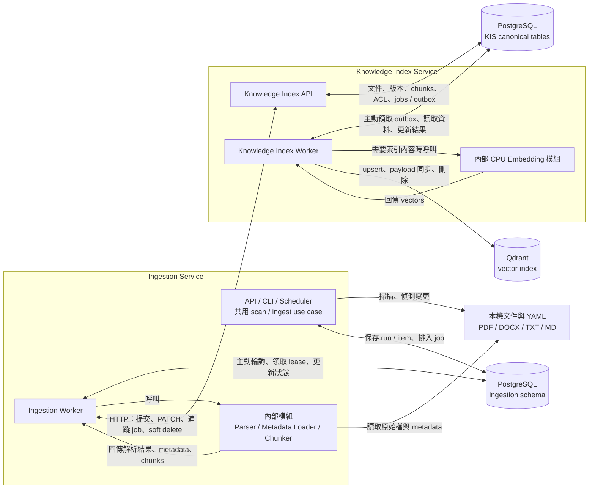

# Ingestion Service

> 學習程式碼時，建議搭配
> [`Python／Clean Architecture 學習指南`](../docs/python-clean-architecture-learning-guide.md)。

Help Desk RAG 的文件匯入服務。第一版讀取本機資料夾中的 `.pdf`、`.docx`、`.txt`、
`.md`，驗證 YAML metadata，解析並切分文件，再交給 sibling
`knowledge-index-service` 產生 embedding 並寫入 Qdrant。

本服務是獨立 sibling project，不直接產生 embedding、不直接存取 Qdrant，也不負責問答。
開發環境使用本機 Docker；部署目標為 Oracle Cloud Linux ARM64、CPU only。

## 系統邊界



本圖只展開匯入路徑；KIS 的查詢 embedding 與 Qdrant 搜尋請看
[`系統總覽：同仁查詢流程`](../README.md#同仁查詢流程)。箭頭依標籤表示呼叫、回傳或讀寫；
PostgreSQL 不會主動推送工作，Worker 會自行輪詢並領取 lease。

Scanner 與 Worker 共用 `ingestion` schema，保存 `sources`、`sync_runs`、`source_items`、
`jobs`；它是匯入進度與工作追蹤資料，不是向量資料庫或原始檔備份。圖中的兩個 PostgreSQL
節點代表資料所有權，預設共用同一個 instance／`knowledge` database。

API、CLI、Scheduler 直接呼叫共用 use case；Scheduler 不透過 HTTP 呼叫 Ingestion API。
Parser／Metadata Loader／Chunker 只回傳處理結果，並不呼叫 KIS；由 Worker 的應用流程
決定要提交新內容、只更新 metadata，或沿用未變更文件的成功結果。

兩個主要流程：

1. `ingestion-service`：掃描來源、偵測新增／修改／消失、解析文件、驗證 metadata、chunking。
2. `knowledge-index-service`：保存文件與版本、embedding、Qdrant indexing 與 retrieval。

未來 SharePoint connector 會實作相同的 source scanner port；第一版只使用本機資料夾。

## Clean Architecture

```text
src/ingestion_service/
├── domain/           純 Python entity、enum、規則與例外
├── application/      use case、DTO、port
├── infrastructure/   local folder、parser、YAML、PostgreSQL、KIS HTTP client
└── presentation/     FastAPI request/response
```

依賴方向為 `presentation -> application -> domain`；infrastructure 只實作 application
定義的 port。PostgreSQL 使用既有的 `knowledge` database，但資料表固定放在獨立的
`ingestion` schema。

## 已實作的規則

- 支援 `.pdf`、`.docx`、`.txt`、`.md`；符號連結、隱藏檔、暫存檔與 sidecar 不會當成文件。
- 文字型 PDF 會保留頁碼；沒有可擷取文字的 PDF 標記為 `ocr_required`，不自行 OCR。
- 必要 metadata 缺漏時，只停止該文件並標記 `metadata_missing`，不從檔名或內文猜值。
- metadata 變更而內容未變時，呼叫 Knowledge Index metadata PATCH，不重新 embedding。
- chunk 預設目標 350 tokens、上限 450、overlap 50；parser 有提供 section heading 時，會放進
  chunk 的可 embedding 內容並保留 citation。PDF 主要保留頁碼，不保證還原章節或表格欄列。
- 單檔預設上限 100 MiB，另有 2,000 萬字元、10,000 chunks 與 25 MB KIS request
  body 防護，全部在送出 HTTP 前檢查。
- 文件連續兩次完整掃描消失才 soft delete；重新出現時沿用 Knowledge Index 文件 ID。
- 同一來源的完整掃描與單檔匯入使用 PostgreSQL advisory lock 序列化。
- DB jobs 支援 lease、指數退避重試、冪等鍵以及索引狀態 polling。
- 每天 `02:00 Asia/Taipei` 自動掃描；若服務在排程時間後才恢復且當日尚未成功掃描，
  scheduler 啟動時會補跑。排程永遠不會自動略過大量刪除保護。
- Worker 與 scheduler 只有在 PostgreSQL probe 成功後才更新 heartbeat；Docker healthcheck
  會偵測程序或 DB 長時間無回應。

## 本機啟動

需求：Docker Desktop / Docker Engine、Docker Compose，以及已完成的 sibling
`knowledge-index-service`。

### 1. 先啟動 Knowledge Index Service

```bash
cd /Users/markhuang/Documents/Codex/2026-07-23/new-chat/knowledge-index-service
cp -n .env.example .env
make network
docker compose up -d --build
make smoke
```

兩個 project 共用 external Docker network `helpdesk-rag`。`make network` 可重複執行，只會
在 network 不存在時建立；external network 不會被任一 sibling project 的
`docker compose down` 移除。若要同時運行另一套隔離環境，兩邊必須使用相同但不同於預設值
的 `HELPDESK_NETWORK`。Knowledge Index 的 Compose 同時提供 PostgreSQL、Qdrant、API 與
embedding worker，並在此 network 使用固定 DNS alias `knowledge-index-api`。Ingestion 不依賴
另一個 Compose project 的通用 service name `api`。

### 2. 設定 Ingestion Service

```bash
cd /Users/markhuang/Documents/Codex/2026-07-23/new-chat/ingestion-service
cp -n .env.example .env
mkdir -p documents
```

至少確認 `.env` 的以下欄位：

```dotenv
# 必須與 knowledge-index-service/.env 的 POSTGRES_PASSWORD 相同
POSTGRES_PASSWORD=knowledge

# 兩個 sibling project 必須相同
HELPDESK_NETWORK=helpdesk-rag

# Knowledge Index 在共用 external network 上的固定 DNS alias
KNOWLEDGE_INDEX_URL=http://knowledge-index-api:8080

# 來源資料夾；正式環境建議使用絕對路徑
DOCUMENT_ROOT_HOST=./documents

# 必須等於 knowledge-index-service/.env 的 API_INTERNAL_KEY
# 若 KIS 開發環境留白，此處也留白
KNOWLEDGE_INDEX_API_KEY=

# 只保護 ingestion-service 自己的 API，與上一個 key 是兩件事
API_INTERNAL_KEY=
```

Oracle／正式環境請設 `APP_ENV=production`；此模式下兩個 key 任一空白都會拒絕啟動，
避免把未驗證的內部 API 暴露出去。

`DOCUMENT_ROOT_HOST` 以唯讀方式 mount 到 container 的 `/data/documents`。公司文件不應
提交到 Git；本專案的 `.gitignore` 與 `.dockerignore` 已排除 `documents/`。

### 3. 啟動服務

```bash
make network
docker compose up -d --build
make smoke
```

`make smoke` 檢查 Compose 的 API / worker / scheduler / migration、liveness、readiness、
Knowledge Index 連線及 service-key 驗證，並且
PDF / DOCX / tokenizer / YAML 執行期套件、default source 與 metrics，不會掃描、
新增或刪除任何文件。第一次啟動時，Knowledge Index 可能仍在下載 embedding model，
readiness 最多等待 15 分鐘。

服務入口：

- OpenAPI：`http://localhost:8090/docs`
- Liveness：`GET http://localhost:8090/health/live`
- Readiness：`GET http://localhost:8090/health/ready`
- Metrics：`GET http://localhost:8090/metrics`

## Metadata

Metadata 由低到高依下列順序合併，後者覆蓋前者：

1. `.env` 的 `SOURCE_DEFAULT_METADATA`
2. 文件根目錄的 `.ingestion.yaml`
3. 從根目錄到文件所在資料夾，各層的 `.ingestion.yaml`
4. 單檔 `<完整檔名>.metadata.yaml` sidecar

例如文件 `hr/policy.pdf` 的單檔 sidecar 必須命名為
`hr/policy.pdf.metadata.yaml`。YAML 檔必須是 UTF-8、上限 1 MiB，且 root 必須是 mapping。

四個必要欄位：

- `title`
- `document_type`
- `owner_department`
- `document_owner`

根目錄 `.ingestion.yaml` 範例：

```yaml
title: 公司文件預設標題
document_type: policy
owner_department: IT
document_owner: helpdesk@example.com
confidentiality: internal
status: published
language: zh-TW
external_llm_allowed: false
acl:
  - principal_type: group
    principal_id: all-employees
    effect: allow
custom_metadata:
  source_system: local-folder
```

單檔 `hr/remote-work.pdf.metadata.yaml` 可只覆蓋差異：

```yaml
title: 遠端工作管理辦法
owner_department: HR
document_owner: hr@example.com
version_number: "1.2"
effective_at: 2026-08-01
review_at: 2027-08-01
custom_metadata:
  category: 人事規章
  regulation_code: HR-001
```

允許的 enum：

- `confidentiality`: `public`, `internal`, `confidential`, `restricted`
- `status`: `draft`, `reviewing`, `published`, `expired`, `archived`
- ACL `principal_type`: `user`, `group`
- ACL `effect`: `allow`, `deny`

`confidential` 與 `restricted` 文件至少要有一筆 `allow` ACL，否則文件會被隔離。
未知的 top-level metadata 欄位會被拒絕；自訂欄位請放在 `custom_metadata`。日期使用
`YYYY-MM-DD`。YAML 可使用 `metadata:` wrapper，但使用時它必須是唯一的 root key。

若同一資料夾的文件不應共用 `title`，請不要在資料夾預設放 `title`，而是在每個 sidecar
明確提供。系統不會以檔名代替缺少的標題。

## 執行匯入

### 完整掃描

CLI：

```bash
docker compose exec ingestion-api ingestion scan
```

API：

```bash
SOURCE_ID=$(curl -s http://localhost:8090/api/v1/sources | python3 -c \
  'import json,sys; print(json.load(sys.stdin)[0]["id"])')

curl -X POST "http://localhost:8090/api/v1/sources/$SOURCE_ID/sync"
```

若有設定 `API_INTERNAL_KEY`，API request 要加：

```text
x-internal-api-key: <API_INTERNAL_KEY>
```

API 會先完成檔案 discovery 與 DB enqueue 才回傳 `202`；`202` 表示文件工作已排入佇列，
不表示 embedding 已完成。以回傳的 `run_id` 查 scan 結果，再從 items/jobs 查處理狀態。

### 單檔匯入

路徑必須是相對於 `DOCUMENT_ROOT_HOST` 的 POSIX path：

```bash
docker compose exec ingestion-api ingestion ingest hr/remote-work.pdf
```

```bash
curl -X POST "http://localhost:8090/api/v1/sources/$SOURCE_ID/files/ingest" \
  -H 'content-type: application/json' \
  -d '{"source_item_id":"hr/remote-work.pdf"}'
```

### 查詢狀態與重試

```bash
docker compose exec ingestion-api ingestion items --limit 100
docker compose exec ingestion-api ingestion item <ITEM_ID>
docker compose exec ingestion-api ingestion job <JOB_ID>
docker compose exec ingestion-api ingestion retry <FAILED_JOB_ID>
docker compose exec ingestion-api ingestion run <RUN_ID>
```

常見 item status：

- `completed`：Knowledge Index 工作已完成。
- `metadata_missing`：必要 metadata 缺少；補 sidecar 後重新 scan/ingest。
- `ocr_required`：掃描型或沒有可擷取文字的 PDF；等待第二階段 OCR。
- `quarantined`：檔案過大、metadata 格式錯誤、chunk/request 超限等永久驗證錯誤。
- `failed`：重試耗盡或外部服務錯誤；確認原因後 retry。
- `missing`：完整掃描未找到，尚未或正等待第二次確認。
- `deleted`：連續缺少達門檻，Knowledge Index 已 soft delete。

## 刪除安全

每次完整掃描只把當次未找到的文件 `missing_scan_count + 1`。預設第二次連續未找到才排入
soft delete；單檔 ingest 不會把其他文件視為消失。

若一次 scan 發現超過 25% 的既有文件消失，或資料夾突然為空，scan 會失敗且不增加任何
missing counter。確認確實是預期的大量移除後，才能人工執行：

```bash
docker compose exec ingestion-api ingestion scan --allow-mass-deletion
```

或：

```bash
curl -X POST \
  "http://localhost:8090/api/v1/sources/$SOURCE_ID/sync?allow_mass_deletion=true"
```

這個旗標只略過比例保護，仍然需要連續兩次掃描消失才刪除。每日排程不會自動設定此旗標。

## API

| Method | Path | 用途 |
|---|---|---|
| `GET` | `/api/v1/sources` | 列出啟用的來源 |
| `POST` | `/api/v1/sources/{source_id}/sync` | 完整掃描並排入工作 |
| `POST` | `/api/v1/sources/{source_id}/files/ingest` | 排入單一檔案 |
| `GET` | `/api/v1/runs/{run_id}` | 查詢掃描結果 |
| `GET` | `/api/v1/items` | 查詢文件，可用 source/status/offset/limit 篩選 |
| `GET` | `/api/v1/items/{item_id}` | 查詢單一文件 |
| `GET` | `/api/v1/jobs/{job_id}` | 查詢 ingestion job |
| `POST` | `/api/v1/jobs/{job_id}/retry` | 重跑失敗的 job |

## 排程與設定

預設排程：

```dotenv
SCHEDULE_HOUR=2
SCHEDULE_MINUTE=0
SCHEDULE_TIMEZONE=Asia/Taipei
```

常用限制：

```dotenv
MAX_FILE_SIZE_BYTES=104857600
MAX_MISSING_RATIO=0.25
MISSING_SCANS_BEFORE_DELETE=2
MAX_DOCUMENT_CHARACTERS=20000000
MAX_DOCUMENT_CHUNKS=10000
KNOWLEDGE_INDEX_MAX_REQUEST_BODY_BYTES=25000000
API_MAX_REQUEST_BODY_BYTES=65536
KNOWLEDGE_INDEX_READINESS_TIMEOUT_SECONDS=5
WORKER_LEASE_SECONDS=3600
ROLE_HEARTBEAT_INTERVAL_SECONDS=10
ROLE_HEARTBEAT_MAX_AGE_SECONDS=60
```

`WORKER_LEASE_SECONDS` 預設一小時，是為 ARM CPU 處理大型文件預留時間。可靠的動態 lease
renewal 仍需要 owner-aware compare-and-set；在完成該機制前，不建議把這個值調得太短。

修改 chunk model/revision 或 token 限制時，必須與 `knowledge-index-service` 使用相同 tokenizer
設定，避免 ingestion 認定可接受但 embedding worker 拒絕。現在兩邊預設都固定為
`intfloat/multilingual-e5-small` revision
`614241f622f53c4eeff9890bdc4f31cfecc418b3`。

## 開發驗證

本機有 `uv` 時：

```bash
uv sync --frozen --extra dev
make lint
make format
make typecheck
make test-unit
make test-integration
```

Integration tests 使用 Testcontainers 啟動真實 PostgreSQL。完整 Docker runtime 驗證：

```bash
docker compose config --quiet
make network
docker compose up -d --build
make smoke
```

查看狀態與日誌：

```bash
make ps
make logs
```

## Oracle Cloud ARM64 部署注意事項

- Docker base images 使用 multi-architecture 的 `python:3.11-slim-bookworm`；本服務不需要 GPU。
- 將 `DOCUMENT_ROOT_HOST` 設為 Linux 絕對路徑，並讓 container user 具有唯讀權限。
- PostgreSQL、Qdrant、Knowledge Index 與 Ingestion 必須加入同一個私有 Docker network。
- 正式環境要設定不同的長隨機 `API_INTERNAL_KEY`，並讓
  `KNOWLEDGE_INDEX_API_KEY` 對應 Knowledge Index 的 key。
- 備份 PostgreSQL volume、Qdrant volume 與原始文件；`ingestion` schema 只保存追蹤狀態，
  不是原始文件備份。
- scheduler 只應運行一個 replica。即使誤啟多份，per-source advisory lock 仍會拒絕同時掃描。
- 100 GB 來源第一次會做全目錄 discovery；之後以相對路徑、mtime、size 與 metadata
  fingerprint 判斷變更。來源檔案應保留可靠的 mtime。

停止服務但保留資料：

```bash
docker compose down
```

不要在尚未備份前對 sibling Knowledge Index 執行 `docker compose down --volumes`，該命令會
移除 PostgreSQL 與 Qdrant 的本機資料 volume。
