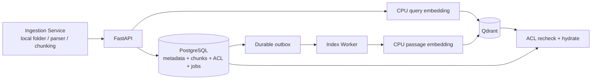

# Knowledge Index Service

Help Desk 知識庫的文件 metadata registry、chunk 儲存、embedding 與 vector index
服務。使用 Python、FastAPI 與 Clean Architecture，可在本機 Docker 開發，部署目標為
Oracle Cloud Linux ARM64、CPU only。

Embedding 全程在本機 CPU 執行，不呼叫付費 embedding API；Qdrant、PostgreSQL 與
multilingual-e5-small 也都可本機運行。實際成本只有執行主機、磁碟與備份資源。

## 本階段範圍

這個元件接收「已解析、已切分」的文件內容，不負責直接讀取 PDF、DOCX 或 SharePoint。
獨立的 Ingestion Service 負責 local-folder connector、
parser 與 chunking，再透過 HTTP 呼叫本服務；SharePoint connector 尚未實作。

- PostgreSQL 是文件、版本、完整 chunk、ACL、工作狀態與 outbox 的唯一真實來源。
- Qdrant 只存向量及檢索需要的最小 payload，不存完整文件內容。
- 針對約 100GB 來源與有限 RAM，vectors、HNSW、payload 預設使用 on-disk 儲存。
- Qdrant collection 名稱會加上 embedding model/revision fingerprint；升級模型時不會
  把不同向量空間混在同一個 collection。
- Worker 使用 `intfloat/multilingual-e5-small` 在 CPU 產生 384 維向量。
- query 自動加上 `query:`，文件 chunk 自動加上 `passage:`。
- 超過模型 512-token 上限的 query/chunk 會明確拒絕，不會靜默截斷內容。
- metadata / ACL 變更只同步 Qdrant payload，不重新 embedding。
- 新版本索引完成後才切換 `current_version_id`，避免查詢到半套資料。
- 刪除採 PostgreSQL soft delete，再由非同步工作刪除 Qdrant points。
- Outbox、lease、重試與內容雜湊讓索引流程可恢復且具冪等性。

## 架構



Clean Architecture 依賴方向：

```text
presentation -> application -> domain
infrastructure -> application ports
domain / application 不依賴 FastAPI、SQLAlchemy、Qdrant、SentenceTransformers
```

## 本機啟動

需求：Docker Desktop / Docker Engine 與 Docker Compose。

Intel Mac 會原生建置 `linux/amd64`；Oracle ARM Linux 會原生建置 `linux/arm64`。本專案的
Linux Torch 固定使用 CPU wheel，並以 `uv.lock` 加上 `uv sync --frozen` 禁止 build 時自動
升級。可用 `make verify-cpu-amd64` 或 `make verify-cpu-arm64` 驗證架構與 `CUDA=None`。

```bash
cp .env.example .env
make network
docker compose up --build
```

`make network` 會在需要時建立 external Docker network
`${HELPDESK_NETWORK:-helpdesk-rag}`。Sibling `ingestion-service` 必須使用相同 network；
任一 project 執行 `docker compose down` 都不會移除它。
KIS API 在共享 network 上另有固定 alias `knowledge-index-api`，其他 sibling service 應使用
`http://knowledge-index-api:8080`，不要依賴容易與其他 Compose project 衝突的 `api` service name。
需要驗證服務金鑰與網路連線的內部 caller，可呼叫受 API middleware 保護的
`GET /api/v1/auth/check`；公開的 `/health/ready` 本身不驗證 API key。

服務：

- API / OpenAPI: `http://localhost:8080/docs`
- PostgreSQL: `localhost:5432`
- Qdrant: `http://localhost:6333/dashboard`
- Liveness: `GET http://localhost:8080/health/live`
- Readiness: `GET http://localhost:8080/health/ready`

完整 Docker smoke test（PostgreSQL metadata、Worker embedding、Qdrant 與 search）：

```bash
make smoke
```

首次執行會下載 embedding model，可能需要數分鐘。若驗證失敗，腳本會自動輸出相關
Compose 服務狀態與最近日誌。
- Metrics: `GET http://localhost:8080/metrics`

第一次啟動會下載 embedding 模型並保存於 `model-cache` Docker volume。API readiness
只有在 PostgreSQL、Qdrant 與 embedding model 都可用時才回傳 200。
CPU-only 環境的 worker lease 預設為 3600 秒，避免大型文件 embedding 超過短 lease 後
被重複處理。

停止但保留資料：

```bash
docker compose down
```

若要連同本機測試資料一起刪除：

```bash
docker compose down --volumes
```

## API

| Method | Path | 用途 |
|---|---|---|
| `POST` | `/api/v1/documents` | 寫入 metadata、版本、chunks，回傳非同步 job |
| `GET` | `/api/v1/jobs/{job_id}` | 查詢索引工作狀態 |
| `POST` | `/api/v1/search` | query embedding、Qdrant 搜尋、PostgreSQL hydrate |
| `PATCH` | `/api/v1/documents/{document_id}/metadata` | 更新 metadata / ACL 並同步 payload |
| `POST` | `/api/v1/documents/{document_id}/reindex` | 重建目前版本索引 |
| `DELETE` | `/api/v1/documents/{document_id}` | soft delete 並刪除 vectors |
| `POST` | `/api/v1/embeddings` | 內部 raw embedding API |

建立文件範例：

```bash
curl -X POST http://localhost:8080/api/v1/documents \
  -H 'content-type: application/json' \
  -H 'x-internal-api-key: change-me' \
  -d '{
    "source_type": "local_folder",
    "source_item_id": "company/hr/remote-work.md",
    "source_version": "mtime:1785292800",
    "title": "遠端工作規章",
    "document_type": "policy",
    "owner_department": "HR",
    "document_owner": "hr@example.com",
    "confidentiality": "internal",
    "status": "published",
    "language": "zh-TW",
    "external_llm_allowed": false,
    "version_number": "1.0",
    "content_hash": "aaaaaaaaaaaaaaaaaaaaaaaaaaaaaaaaaaaaaaaaaaaaaaaaaaaaaaaaaaaaaaaa",
    "mime_type": "text/markdown",
    "file_size": 100,
    "parser_name": "markdown",
    "parser_version": "1",
    "source_path": "/data/company/hr/remote-work.md",
    "custom_metadata": {"category": "人事規章"},
    "acl": [
      {"principal_type": "group", "principal_id": "all-employees", "effect": "allow"}
    ],
    "chunks": [
      {
        "content": "員工每週可以遠端工作兩天。",
        "section_path": "遠端工作",
        "token_count": 15
      }
    ]
  }'
```

`content_hash` 是 ingestion 送入 KIS 的 **index-payload fingerprint** SHA-256，不是原始檔案
bytes hash。第一版 ingestion 以穩定序列化後的 parser name/version 與 chunks（content、
section path、page number、token count）計算；因此 parser 或 chunking 輸出改變時會建立新
版本。同一來源、同一 fingerprint 重送不會建立重複版本；若前一次索引已失敗，重送會建立
新的 retry job。當 embedding model 或 revision 變更時，即使 fingerprint 相同也會建立新的
索引版本。

`POST /documents` 的冪等判斷以內容 hash 與 embedding model/revision 為準。同一內容再次
POST 時，即使 metadata 不同，也只會回傳既有版本，不會把新 metadata 套用到既有版本。
ingestion connector 偵測到「內容未變、metadata/sidecar 有變」時，必須改用 metadata
PATCH。若匹配的既有版本不是目前版本，或另一個版本仍在索引中，POST 會視為版本重新啟用：
切換 `current_version_id`、套用本次提交的 metadata/ACL 與版本生命週期欄位，並確保建立
reindex job。這讓 A→B→A 的內容回退不會被誤判成單純重送。

例外是同一 `source_type + source_item_id` 的文件已被 soft delete、之後又重新出現：此時
POST 會視為 restore，保留原本的 `document_id`、清除 `deleted_at`，並重新套用提交的文件
metadata 與 ACL。若 content/model fingerprint 相同，會沿用既有 version、更新其
`version_number`、`source_version` 與生命週期日期，並強制建立 reindex job；若內容不同，
則建立新 version。Restore 會先把 `current_version_id` 指向目標 version，避免舊 version
在恢復期間被當成目前內容；呼叫端仍須等待回傳 job 完成後，才能視為可搜尋。

重複送出相同 restore 時不會重複建立 version，且在 restore job 尚未完成時會回傳最新的
active job。Worker 執行 delete 前會重新檢查 canonical tombstone；已經被 restore 的舊
delete event 會跳過。若 delete 已在 Qdrant 執行期間才發生 restore，服務會在刪除後再排
一個 recovery reindex，使最後的 canonical 狀態最終生效。

目前版本的 metadata-only 更新範例（不會重新 embedding）：

```bash
curl -X PATCH http://localhost:8080/api/v1/documents/$DOCUMENT_ID/metadata \
  -H 'content-type: application/json' \
  -H 'x-internal-api-key: change-me' \
  -d '{
    "version_number": "1.1",
    "source_version": "mtime:1785379200",
    "effective_at": "2026-08-01",
    "expires_at": "2027-07-31",
    "review_at": null
  }'
```

`version_number`、`source_version`、`effective_at`、`expires_at`、`review_at` 只會更新
`current_version_id` 指向的目前版本。日期欄位省略代表維持原值，傳入 ISO 日期代表設定，
明確傳入 `null` 則會清除；`version_number` 與 `source_version` 不可傳 `null` 或空白。
若 `effective_at` 與 `expires_at` 同時有值，`expires_at` 不得早於 `effective_at`。
`source_url` 同樣採 tri-state：省略維持原值、字串代表設定、明確 `null` 代表清除。

`DELETE /documents/{document_id}` 具 response-loss 冪等性。文件已是 soft-deleted 時，重送
DELETE 會回傳該文件最新的 delete job；即使該 job 已 completed，也維持相同 `job_id` 與
terminal status，不會建立重複 delete job。

查詢範例：

```bash
curl -X POST http://localhost:8080/api/v1/search \
  -H 'content-type: application/json' \
  -H 'x-internal-api-key: change-me' \
  -d '{
    "query": "一週可以遠端工作幾天？",
    "limit": 8,
    "filters": {
      "user_id": "user-object-id",
      "group_ids": ["all-employees"],
      "statuses": ["published"],
      "language": "zh-TW"
    }
  }'
```

搜尋結果包含 `version_number`、`effective_at`、`expires_at`、頁碼/section、`token_count`、
`chunk_index`，以及 PostgreSQL canonical document 的 `external_llm_allowed`、
`confidentiality`、`language`、`status`。呼叫外部 LLM 前必須依回傳的
`external_llm_allowed` 執行資料外送政策，不可信任可能尚未同步的 Qdrant payload。
`token_count` 保證為正整數；優先使用 canonical chunk 值，舊資料為 `NULL` 時以 UTF-8 byte
length 做保守且 deterministic 的 context-budget fallback。

`statuses` 省略時預設為 `published`；為維持 API 相容，空陣列仍可送入，但服務會 fail-closed
並同樣視為只查 `published`。尚未生效或已過期的版本會在 PostgreSQL 最終驗證階段排除。
日期依 `BUSINESS_TIMEZONE` 判斷，預設 `Asia/Taipei`，且 `expires_at` 當天仍有效。

搜尋先取 `limit * 3` 個候選；若 canonical ACL、版本或 lifecycle 驗證後仍不足，會以 Qdrant
offset 漸進取得後續候選，直到回滿 `limit`、候選耗盡或達到
`MAX_SEARCH_CANDIDATES`（預設 500）。因此結果仍可能少於 `limit`，但不會只因最前面的 stale
或過期 chunks 佔滿第一批候選就立即漏掉後續有效答案。
每一候選頁會批次讀取 chunks、documents、ACL 與 versions，PostgreSQL query 數固定，不會隨
候選文件數量形成 N+1。

如果 `.env` 的 `API_INTERNAL_KEY` 留白，開發環境不檢查
`x-internal-api-key`。`APP_ENV=production` 時服務會拒絕空白 `API_INTERNAL_KEY`，也會拒絕
空白或 `local-development-only` 的 `QDRANT_API_KEY`。

## Metadata 與 ACL

PostgreSQL 保存：

- 來源：`source_type`、`source_item_id`、`source_path`、`source_url`、`source_version`
- 管理責任：`owner_department`、`document_owner`、`review_at`
- 文件生命週期：`status`、`effective_at`、`expires_at`
- 安全：`confidentiality`、`external_llm_allowed`、user/group allow/deny ACL
- 版本與處理：hash、MIME type、parser/model version、indexing status
- 檢索內容：完整 chunk、section、頁碼、token count
- 擴充欄位：`custom_metadata` JSONB

Qdrant payload 只有 document/version/chunk ID、目前版本旗標、狀態、語言、機密等級與
ACL filter 欄位。查詢即使已通過 Qdrant filter，回傳 chunk 前仍會用 PostgreSQL 最新
資料再次驗證，避免 ACL 同步延遲造成越權。

ACL 沒有任何 `allow` 規則時，代表公司內部所有呼叫者可查詢；`confidential` 與
`restricted` 文件則強制至少設定一個 user/group `allow` ACL，避免誤設成全公司可見。

## 測試

```bash
uv sync --frozen --extra dev
make lint
make typecheck
make test-unit
make test-integration
```

- unit tests 使用 in-memory fakes，快速驗證應用流程。
- integration tests 使用 Testcontainers 真正啟動隔離的 PostgreSQL 16 與 Qdrant
  1.18.3，驗證兩個 adapter；不是 mock Qdrant。
- 執行 integration tests 時 Docker daemon 必須運作，第一次可能需要下載測試 images。
- 目前鎖定的 Torch 不提供 Intel Mac wheel；Intel Mac 請使用上面的 Docker Compose
  流程與 `make smoke` 驗證完整服務。

## GitHub 收錄範圍

- 保留 `src/`、`tests/`、`scripts/`、`migrations/`、`uv.lock`、`.env.example` 與
  建置／部署設定，讓 clone 後能重現環境、執行測試與資料庫遷移。
- `.gitignore` 排除本機 `.env` 及其變體、憑證／私鑰、虛擬環境、快取、日誌、
  coverage／建置產物、本機資料、備份與編輯器設定。
- 實際環境值只存放在 `.env`；新增設定時同步更新不含實際密鑰的 `.env.example`。
- Docker build context 僅包含 Dockerfile 使用的程式碼、遷移、文件與依賴設定。

## 正式部署前

- 升級 embedding model 前先驗證新版本，再更新已鎖定的 `MODEL_REVISION` commit SHA。
- 設定強密碼、`API_INTERNAL_KEY`、網路限制、TLS、備份及 volume 容量告警。
- PostgreSQL 與 Qdrant 不應直接暴露公網。
- Oracle ARM64 上依實際資料量與查詢負載調整 batch size、Torch threads、CPU/memory。
- 預設每個 API/Worker 程序只允許一個 embedding batch、使用 2 個 Torch threads；
  壓測後再調整 `EMBEDDING_MAX_CONCURRENCY` 與 `TORCH_NUM_THREADS`。
- 文件 parser、local-folder connector 與每日排程已由獨立 Ingestion Service 提供，
  不屬於本服務職責；SharePoint/Microsoft Graph connector 與 OCR 仍未實作。
